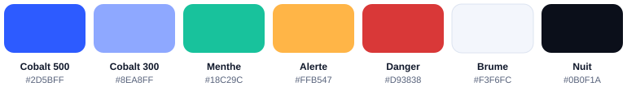

# Identité visuelle « Cobalt net » — Gestion Fichiers

Un bleu cobalt pour la marque et les actions, une pointe menthe pour « en ordre », la police Manrope. L'identité est pensée d'abord pour le thème sombre et appliquée depuis la version 2.3.

## Icône

- **Dessin** : un dossier blanc compact devant deux fiches rangées, avec une pastille menthe et une coche, sur fond cobalt #2D5BFF.
- **Construction** : grille Android de 108 dp ; tout le dessin tient dans la zone sûre (cercle de 66 dp). Dossier de 56 × 34.
- **Règle** : aplats uniquement, sans dégradé ni ombre, pour rester net à 24 px.
- **Variantes** : rond, carré arrondi, thématique monochrome (Android 13+, teintée par le système), versions simplifiées à 48, 32 et 24 px.
- **Écran de démarrage** : fond cobalt avec l'icône (Android 12+).
- **Fichiers** : `app/src/main/res/drawable/ic_launcher_foreground.xml` et `ic_launcher_monochrome.xml`.

## Logo

Mot-symbole « gestion**fichiers** » en Manrope ExtraBold, en minuscules, « fichiers » en cobalt #2D5BFF (fond clair) ou #8EA8FF (fond sombre), à droite de l'icône.

## Couleurs de marque

| Rôle | Couleur | Code |
|---|---|---|
| Marque, actions | Cobalt 500 | #2D5BFF |
| Marque en thème sombre | Cobalt 300 | #8EA8FF |
| Succès, « à jour » | Menthe 500 | #18C29C |
| Alerte (stockage > 90 %) | Orange | #FFB547 |
| Danger (suppression) | Rouge | #D93838 (clair) · #FF8A8A (sombre) |
| Fond clair « brume » | Neutre | #F3F6FC |
| Fond sombre « nuit » | Neutre | #0B0F1A |
| Texte principal | Encre | #0F172A (clair) · #E6EBF5 (sombre) |
| Texte secondaire | Gris | #556079 (clair) · #9AA6C0 (sombre) |

Gamme cobalt : 50 #EEF2FF · 100 #DCE4FF · 200 #B9C9FF · 300 #8EA8FF · 400 #5B7FFF · 500 #2D5BFF · 600 #1F45E0 · 700 #1835B0 · 800 #142A85 · 900 #0F1F5C.

Les couleurs automatiques du téléphone (Android 12+) ne sont pas utilisées, pour garder l'identité. Les valeurs sont définies dans `app/src/main/java/com/example/gestionfichiers/ui/Theme.kt`.

## Couleurs par type de fichier

| Type | Thème clair | Thème sombre |
|---|---|---|
| Dossier | #2D5BFF | #5B7FFF |
| Image | #12A37F | #4FD8B4 |
| Vidéo | #E8590C | #FF9B57 |
| Audio | #8B5CF6 | #C08CFF |
| PDF | #D93838 | #FF8A8A |
| Archive (ZIP, RAR, 7Z…) | #A0703E | #D7A97E |
| Application (APK) | #3F8F3A | #8FD58A |
| Document, tableur, présentation | #0284C7 | #5CC8F5 |
| Autre | #64748B | #9AA6C0 |

L'extension s'affiche dans un petit badge de la couleur du type, en bas à droite de l'icône ou de la miniature.

## Typographie

Manrope, intégrée à l'application (`app/src/main/res/font/`, licence [OFL](licences/Manrope-OFL.txt)).

| Niveau | Taille / graisse | Exemple |
|---|---|---|
| Titre | 22–26 / 800 | Téléchargements |
| Section | 18 / 700 | Plus gros fichiers |
| Corps | 15 / 500 | Facture-octobre.pdf |
| Détail | 12 / 500 | 1,2 Mo · 3 nov. 2026 |
| Étiquette | 11 / 700, majuscules espacées | ACCÈS RAPIDE |

## Formes et composants

- **Arrondis** : boutons et champs 12, cartes et lignes 16, boîtes de dialogue 24.
- **Bouton « + Dossier »** : plein cobalt, texte blanc.
- **Fil d'Ariane** : étapes en contour, étape courante pleine cobalt.
- **Sélection** : fond cobalt pâle, bordure cobalt de 2 px, coche à la place de l'icône.
- **Barre de sélection** : flottante, sombre dans les deux thèmes, arrondie à 22 ; « Supprimer » en rouge clair.
- **Jauge d'espace** : cobalt en clair, menthe en sombre, orange au-delà de 90 %.
- **Onglets** : soulignés en cobalt, croix sur l'onglet actif.
